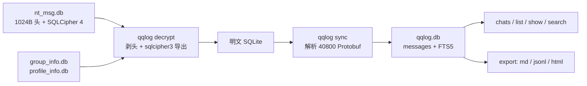

# qqlog

在 macOS 上把本地 QQ NT 聊天记录变成能查询、能导出的数据。

qqlog 面向「想把自己电脑上的 QQ 聊天记录留一份」的人：它读取本机 QQ 已经同步下来的数据库，在本地解密、建索引，然后按会话检索或导出为 Markdown / JSONL / HTML。全程离线，没有账号登录，也不会上传任何内容。

## 它能做什么

- **解密**：处理 NTQQ 的 `nt_msg.db`（1024 字节自定义头 + SQLCipher 4），同时解密 `group_info.db` / `profile_info.db` 以还原群名和好友昵称。
- **建索引**：把 `40800` 字段里的 Protobuf 消息体解析成文本，写入带 FTS5 的 SQLite 索引，支持中文全文检索。
- **查询**：列出会话、看最近消息、按时间区间查看、跨会话或限定会话搜索。
- **导出**：单个会话或全量导出为 Markdown / JSONL / HTML，可按时间区间裁剪。
- **增量同步**：QQ 收到新消息后重新同步，只处理新增部分。

## 快速开始

前置条件：

- macOS（Apple Silicon 已验证；Intel 未验证）
- 本机 QQ NT 已登录，且聊天记录已经同步到本地
- Python ≥ 3.10 与 [uv](https://docs.astral.sh/uv/)
- Xcode Command Line Tools（仅用于取密钥时的 `lldb`）

### 1. 取得数据库密钥

NTQQ 的 SQLCipher 密码是 16 字节 ASCII 字符串，无法从数据库文件离线推导，必须在 QQ 登录、打开数据库的那一刻从进程内存中读取。这一步不属于本仓库，请按上游教程操作：

- [QQBackup/qq-win-db-key](https://github.com/QQBackup/qq-win-db-key)（脚本）
- [QQDecrypt](https://qqbackup.github.io/QQDecrypt/)（分平台教程，含 macOS ARM 免关 SIP 的步骤）

要点是先对 `QQ.app` 做 ad-hoc 重签名，再用 `lldb` 在 `nt_sqlite3_key_v2` 下断点，然后登录一次。这一步会修改 `/Applications/QQ.app` 的签名，QQ 可能提示「已被修改」；重装或更新 QQ 后需要重做。

### 2. 安装

```bash
git clone https://github.com/<your-name>/qqlog.git
cd qqlog
uv sync
```

### 3. 配置密钥

```bash
uv run qqlog key set '<你的 16 字节密钥>'
```

密钥保存在 `~/Library/Application Support/qqlog/config.json`，权限 `0600`。

### 4. 解密并建索引

```bash
uv run qqlog decrypt   # 解密主库、群信息库、联系人库
uv run qqlog sync      # 解析消息、写入索引与 FTS5
uv run qqlog status
```

成功的标志是 `status` 输出里出现消息总数与会话数：

```text
messages    : 216108 in 43 chats
```

实测 21.6 万条消息的全量索引约 5 秒（Apple Silicon）。

### 5. 开始查询

```bash
uv run qqlog chats                 # 会话列表（含群名/昵称）
uv run qqlog list <群号或QQ号> -n 20
```

## 常用命令

| 命令 | 作用 |
| --- | --- |
| `qqlog status` | 查看配置路径、数据库大小、消息总数 |
| `qqlog decrypt [--force]` | 解密 `nt_msg.db` 及其附属库 |
| `qqlog sync [--force]` | 增量导入新消息并重建全文索引 |
| `qqlog chats [--limit N] [--json]` | 列出会话，按最近活跃排序 |
| `qqlog list <会话> [-n N]` | 看某会话最近 N 条 |
| `qqlog show <会话> --after 2026-10-01 [--before 2026-10-10]` | 按时间区间查看 |
| `qqlog search <关键词> [-c 会话] [-n N]` | 全文检索，命中处高亮 |
| `qqlog export <会话> --format md\|jsonl\|html --out DIR` | 导出单个会话 |
| `qqlog export --all --format jsonl --out DIR` | 全量导出，每个会话一个文件 |

`<会话>` 可以填群号、QQ 号，或群名/昵称的一部分；匹配到多个时会列出候选让你收窄。

## 导出格式

JSONL 每行一条消息，字段固定，便于二次处理：

```json
{"chat_type": "c2c", "chat_id": "123456789", "msg_id": "7668209017844886248", "ts": 1785391992, "time": "2026-07-30 14:13:12", "sender": "987654321", "direction": 1, "kind": "text", "text": "感觉比较丝滑"}
```

`direction = 1` 表示自己发出，`0` 表示收到；`kind` 为 `text` / `image` / `file` / `element:<类型号>`，非文本消息的 `text` 为空。

全量导出时文件名形如 `c2c_<昵称>_<QQ号>.jsonl`、`group_<群名>_<群号>.jsonl`，同名不同号也不会互相覆盖。

## 工作原理



依赖只有一个：`sqlcipher3`。其余使用标准库（`sqlite3`、`argparse`）和手写的 Protobuf 读取器，无需编译工具链。

## 数据与安全

| 内容 | 位置 |
| --- | --- |
| 配置与密钥 | `~/Library/Application Support/qqlog/config.json`（`0600`） |
| 解密后的明文库 | `~/Library/Application Support/qqlog/nt_msg_plain.db` |
| 索引库（含 FTS5） | `~/Library/Application Support/qqlog/qqlog.db` |

- 所有处理都在本机完成，代码里没有任何网络请求。
- 明文库和索引库就是完整的聊天记录，请自行控制访问权限；不需要时直接删除整个 `qqlog` 目录即可。
- 密钥请不要提交到仓库、粘贴到 issue 或发到聊天窗口。

## 兼容性

| 项目 | 状态 |
| --- | --- |
| QQ NT 7.0.2（macOS，arm64） | 已实测：解密、同步、检索、导出均通过 |
| 其他 QQ NT 版本 | 未验证；字段编号理论上稳定，但消息体（`40800`）的结构可能变化 |
| Windows / Linux | 未验证；解密与索引用的是纯 Python，理论上跨平台，但路径发现只适配 macOS |
| 旧版 PCQQ / 手机 QQ | 不支持 |

## 风险与边界

- **取密钥需要调试器**：`lldb` 附加到 QQ 进程属于中等风险操作，建议只在第一次取密钥时做一次，之后复用缓存的密钥。导出本身只是读本地文件，不产生网络行为。
- **重签名有副作用**：ad-hoc 签名后 QQ 可能提示「已被修改」，应用更新后需要重新签名。
- **只导出已有数据**：能拿到的就是本机 QQ 已经同步下来的记录，更早的历史需要先在 QQ 里迁移到本机。
- **不恢复已删除消息**，生成内容也不具备法律取证效力。
- 仅用于导出**你自己**账号在本机上的数据。

## 贡献

Issue 请附上 QQ 版本、macOS 版本、CPU 架构和完整报错；如果是消息解析问题，附一条能复现的最小样例（去除隐私内容）。PR 欢迎，保持依赖最小即可。

## License

[MIT](LICENSE)
